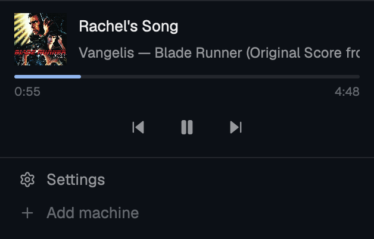

# herdr-mods

Mods for [Herdr](https://herdr.dev), the desktop app. Each folder is one entry for the [herdr.dev mods gallery](https://herdr.dev/gallery/?type=mods).

## Music Remote

A music remote at the bottom of the Herdr sidebar. It shows what your computer is playing, in Apple Music, Spotify, Podcasts or a browser tab, with artwork, title, artist, progress, and previous, play/pause and next buttons. It is not tied to one player. When several apps have a session, a list picks which one the block controls.



Version 0.9.0. Runs on macOS 15.4 or later and on Windows 11.

**Linux is not supported yet.** On Linux the block shows only a note that it has no backend, with no controls.

### Install

Give your agent (Claude Code, Codex and the like) this prompt:

```
Read ~/.config/herdr-app/AGENTS.md, then add this mod: https://github.com/slashpot/herdr-mods/tree/main/music-remote
```

To update later, give it this one:

```
Read ~/.config/herdr-app/AGENTS.md, then update the music-remote mod to the latest https://github.com/slashpot/herdr-mods/tree/main/music-remote
```

Or install it from a clone yourself:

```sh
git clone https://github.com/slashpot/herdr-mods.git
cd herdr-mods
./music-remote/install.sh
```

On macOS, `install.sh` builds a small native helper with clang, so it needs the Xcode Command Line Tools (`xcode-select --install`). On Windows, run it from Git Bash with `herdr-app` and Python on `PATH`. Nothing is built there.

The script then does these steps:

1. It copies the mod to `~/.config/herdr-app/mods/music-remote`, or to `$HERDR_APP_HOME/mods/music-remote` when that is set.
2. It makes a `main-music-remote` layout, which is herdr's `main` with the block in the sidebar, and switches the window to it. It never changes a layout file that already exists.
3. It adds the hotkeys below to `keys.json`. It skips a key you already use.

herdr-app reloads the mod and the keys by itself.

### Use

| Key | Does |
|---|---|
| `cmd-alt-p` | play or pause |
| `cmd-alt-.` | next track |
| `cmd-alt-,` | previous track |
| `cmd-alt-s` | show the next session |
| `cmd-alt-l` | open the session list |

`cmd` is Command on macOS and the Windows key on Windows. The keys work while the Herdr window has focus. For keys that work from any app, bind `herdr-app do music-remote.toggle` (or `next`, `previous`) in a launcher such as Raycast.

Click the cover to bring the player to the front.

### Before you install

- The mod runs local programs to reach the OS media controls. On macOS it runs `/usr/bin/perl`, `osascript` and `open`. On Windows it runs `powershell.exe` and `explorer.exe`. It makes no network requests.
- On macOS it uses MediaRemote, a private Apple framework. A macOS update can break it.
- The first time you control Music or Spotify, macOS asks whether Herdr may control that app. Until you allow it, the button does nothing.

### Known issues

- On macOS, a paused browser tab can only be shown, not controlled. Its buttons are dimmed.
- On Windows, the hotkeys have been tested only through `herdr-app do`, not with real key presses. Windows reserves some Win+Alt combinations.
- On Windows, clicking the cover of a Chrome session may open a new Chrome window.

### Uninstall

1. Delete `~/.config/herdr-app/mods/music-remote`.
2. Delete `~/.config/herdr-app/layouts/main-music-remote.json`.
3. Remove the `music-remote.*` lines from the `global` section of `keys.json`.

The design and the per-OS details are in [music-remote/README.md](music-remote/README.md).

## Credits

The macOS helper loads into `/usr/bin/perl` to get around MediaRemote's entitlement check. That technique comes from [ungive/mediaremote-adapter](https://github.com/ungive/mediaremote-adapter) (BSD-3-Clause).

## License

[MIT](LICENSE)
