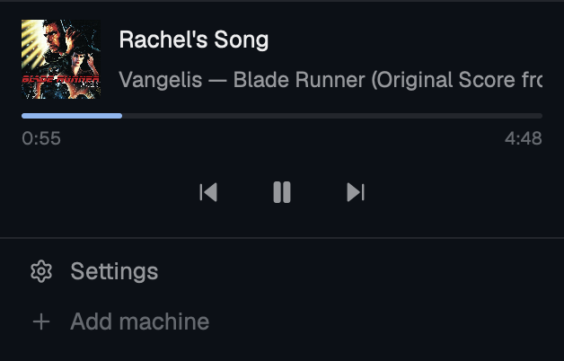

# Music Remote

A music remote at the bottom of the sidebar for whatever your computer is playing: Apple Music, Spotify, Podcasts, or YouTube in a browser, on macOS and Windows. It shows the artwork, title, artist and album, a progress bar, and previous, play/pause and next buttons. When several apps are playing or paused, a list button picks which one the block controls. Linux is not supported yet.

## What you see

- A block 132px tall in the sidebar, between `agents` and `sidebar-footer`. It has the `chrome` background, a 1px `border` line on top, 12px side padding, 10px top and 6px bottom.
- Top row: a 44px cover with 6px corners. Beside it, the title is 13px medium `foreground` and the subtitle is 12px `muted`. The subtitle reads "artist — album", or the app's name when both are empty. Without artwork the cover is a `hover` square with a music note in `dim`.
- A progress bar 3px tall. The track is `border` and the fill is `accent`. Under it, the elapsed and total times are 10px `dim`, such as `0:19` and `9:34`. A live stream has no duration, so it shows no bar.
- A centered row of round buttons: previous (14px icon), play or pause (16px icon) and next (14px icon), 14px apart. Icons are `muted`, and on hover they turn `foreground` on a `hover` circle.
- With more than one session, a list button sits at the right end of that row. It is a 13px list icon and the session count in 11px `dim`.
- In a sidebar narrower than 160px, the block shows a 36px cover above the play/pause button.
- With nothing playing, the block shows a music note and "Nothing playing" in 12px `dim`. On a platform with no backend it says "Music Remote has no backend for <platform> yet".
- The list is a popup 260px wide, titled "Music Remote". Each 40px row shows a 28px cover, the title, the app name and a small play or pause icon. The icon is `accent` while that session plays. The row the block shows has the `selected` background.

## How it behaves

- The block shows one session. Its choice, in order: the session you picked, then the one the OS sends media keys to, then any that is playing, then the first.
- A session that starts playing becomes the pick, so the block follows whatever you started last. When the picked app's session goes away, the pick is cleared.
- Buttons and keys act on the shown session's app. Play/pause sends `play` or `pause` to match the button, never a blind toggle. The button flips at once, and the next read confirms it.
- The block reads the OS every 1.5 s. Between reads, the progress bar moves forward once a second while the track plays.
- A title or subtitle wider than its box rests 1.5 s, glides to its end at 30 px/s, rests again and glides back.
- Clicking the cover brings the app to the front.
- Clicking a row in the list shows that session in the block and closes the list. A second press of the list button or key, Esc, or a click outside also closes it.
- When the OS lists an app that it won't take commands for, the block dims its buttons to 40% opacity and presses do nothing.
- Keys, in the `global` section of `keys.json`:

  | Key | Command | Does |
  |---|---|---|
  | `cmd-alt-p` | `music-remote.toggle` | play or pause |
  | `cmd-alt-.` | `music-remote.next` | next track |
  | `cmd-alt-,` | `music-remote.previous` | previous track |
  | `cmd-alt-s` | `music-remote.cycle` | show the next session |
  | `cmd-alt-l` | `music-remote.sessions` | open or close the list |

  `music-remote.play` and `music-remote.pause` exist unbound. `herdr-app do music-remote.toggle` runs any of them from a shell.

## Built from

- `mods/music-remote/main.js` is the view, and `mod.json` is `{ "place": "none", "title": "Music Remote" }`. The layout places it as a block, `{ "id": "music-remote", "type": "block", "size": { "px": 132 }, "content": { "mod": "music-remote" } }`, inside the `sidebar` column just before `sidebar-footer`.
- The list is the same mod opened with `openOverlay({ mod: "music-remote", props: { view: "sessions" }, kind: "popup", width: 260 })`. The `cmd-alt-l` key places it where the list button sits, using the layout's block sizes and the viewport.
- The pick lives in `shared("music-remote.pinned")` as an app key, so the block and the list agree. Only the sidebar copy reads `nextCommand()`, so a key never acts twice.
- `main.js` picks a backend by `window().platform`. Each backend lives in `native/<platform>/backend.js` and exports `get()`, `send(command, bundle)`, `activate(track)` and `settleMs`. `get()` returns `{ elected, sessions }`, and each session has `title`, `artist`, `album`, `app`, `bundle`, `duration`, `elapsed`, `rate`, `timestamp`, `art`, `controllable` and `pickable`.
- macOS uses MediaRemote. `native/macos/nowplaying.m` builds to `bin/libnowplaying.dylib` with `native/macos/build.sh` (clang, arm64 and x86_64). Since macOS 15.4, MediaRemote returns empty data to a binary that lacks Apple's entitlements, so `nowplaying.pl` loads the dylib into the entitled `/usr/bin/perl`. Music and Spotify get their commands through `osascript` instead.
- Windows uses GSMTC through `native/windows/nowplaying.ps1` in Windows PowerShell 5.1, which ships with Windows. Nothing is built.
- Artwork is written under `data/music-remote/` as `<app>-<content hash>.jpg|png`, and files no session uses are pruned.
- Icons are `icons/*.svg`: play, pause, skip-back, skip-forward, list and music.

## Watch out

- On macOS, build the helper before the first load: run `mods/music-remote/native/macos/build.sh`. It needs the Xcode Command Line Tools. `bin/` is not in the repo.
- The mod runs programs. On macOS it runs `/usr/bin/perl`, `osascript` and `open`. On Windows it runs `powershell.exe` and `explorer.exe`. It makes no network requests.
- Copy the mod folder, never symlink it. herdr-app does not render `svg()` icons from a symlinked mod.
- The mod adds no block by itself. Add the block above to the person's layout. `install.sh` clones `main` into `layouts/main-music-remote.json` with the block in place, and leaves an existing file alone.
- The first AppleScript command to Music or Spotify makes macOS ask whether Herdr may control that app. Until the person answers, the press does nothing.
- On macOS, only the app the OS sends media keys to takes a targeted command through MediaRemote. A paused browser tab stays listed with its buttons dimmed.
- On Windows, `cmd` is the Windows key, and Windows reserves some Win+Alt keys.
- Linux has no backend yet. The block says so.

## Done when

- `herdr-app check mods/music-remote` passes, and the block shows the current track's cover, title and subtitle within 2 s of loading.
- Play/pause, next and previous change the player's real state. `herdr-app do music-remote.toggle` does the same.
- With two apps that each have a session, the list button shows `2`. Clicking the other row switches the block to it.
- Starting playback in another app moves the block to that app.
- A long title scrolls, rests at both ends, and never jumps back mid-glide.
- In a sidebar narrower than 160px, the block shows only the cover and play/pause.
